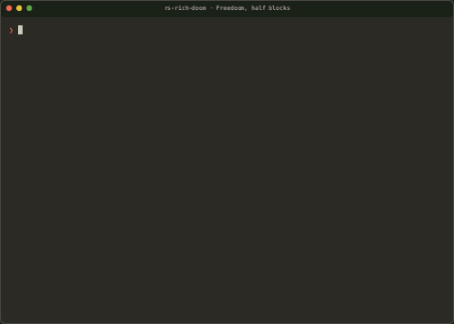

# rs-rich-doom

Doom in the terminal, drawn and driven by [rs-rich](https://github.com/buchochelliq-labs/rs-rich-cli)
and its TUI framework [intuiTUIve](https://buchochelliq-labs.github.io/rs-rich-cli/latest/guide/intuituive/).



**[Watch it with sound](docs/media/doom-play.mp4)** (30 s, MP4: the first demo
in half blocks at 160x45 in xterm, with the game's effects and OPL music;
made by [docs/media/play/record.sh](docs/media/play/record.sh)).

*Freedoom's first demo (`-- -playdemo demo1`) in half blocks, 100x32, 35
frames a second; also [in Kitty graphics](docs/media/doom-kitty/doom-kitty.gif)
and as animated PNGs ([half blocks](docs/media/doom-half/doom-half.apng),
[Kitty](docs/media/doom-kitty/doom-kitty.apng)). The footage is
[Freedoom](https://freedoom.github.io/) (BSD licence), not id's data; no
game data is in this repository. Recorded with
[rs-rich-record](https://github.com/buchochelliq-labs/rs-rich-cli/tree/main/crates/rich-record)
(`rich record`), which follows the program on a PTY and decodes its Kitty
images: the tapes are [docs/tapes](docs/tapes), and re-recording takes the
IWAD's directory as the current one (see the tapes' comments). The GIFs and
APNGs were recorded before the move to the rs-rich 0.0.21 crates; half
blocks and Kitty draw the same picture since. Freedoom's licence for the
footage: [docs/media/FREEDOOM-COPYING.txt](docs/media/FREEDOOM-COPYING.txt).*

Real Doom in the terminal. The engine is id Software's GPL release of Doom,
through [doomgeneric](https://github.com/ozkl/doomgeneric) (Chocolate Doom's
code with a six-function platform layer); the picture, the keyboard and the
app loop are the [rs-rich](https://github.com/buchochelliq-labs/rs-rich-cli)
crates, from crates.io (the 0.0.21 cohort): [rs-rich-art](https://crates.io/crates/rs-rich-art) (Kitty, Sixel and
iTerm2 encoders), [rs-rich-ext](https://crates.io/crates/rs-rich-ext) (capability detection, the graphics side
channel), [rs-rich-interact](https://crates.io/crates/rs-rich-interact) (the terminal session, raw input, the kitty
keyboard protocol, synchronized output) and [intuiTUIve](https://buchochelliq-labs.github.io/rs-rich-cli/latest/guide/intuituive/) (the app; pixel
cells; held keys; `fixed_step`, which is the game's clock; the frame-rate
meter and stats; the audio output). Doom draws its own HUD; the app adds
nothing over it but an optional fps counter. What rs-rich still lacks for
this, and could take into core, is in
[docs/core-gaps.md](docs/core-gaps.md).

## Built with rs-rich and intuiTUIve

rs-rich-doom is a demo of what the rs-rich crates can drive: a 35 Hz game
with its own picture, held keys and sound, in an ordinary terminal.

- **[rs-rich](https://github.com/buchochelliq-labs/rs-rich-cli)**: a Rust
  port of Python's [rich](https://github.com/Textualize/rich), with the
  `rich` command line, terminal graphics, recordings and interactive
  components. [Documentation](https://buchochelliq-labs.github.io/rs-rich-cli/latest/) ·
  [crates.io](https://crates.io/crates/rs-rich).
- **[intuiTUIve](https://buchochelliq-labs.github.io/rs-rich-cli/latest/guide/intuituive/)**: rs-rich's TUI framework
  (signals, a retained tree, a cell screen, held keys, a fixed-step clock,
  audio output), which runs this game.
  [Tutorial: a to-do app](https://buchochelliq-labs.github.io/rs-rich-cli/latest/guide/intuituive/tutorial/) ·
  [crates.io](https://crates.io/crates/rs-rich-intuituive) ·
  [source](https://github.com/buchochelliq-labs/rs-rich-cli/tree/main/crates/rich-intuituive).

What Doom needed and rs-rich did not yet have became rs-rich work: see
[docs/core-gaps.md](docs/core-gaps.md).

DOOM is a registered trademark of id Software LLC, a ZeniMax Media company.
rs-rich-doom is not affiliated with or endorsed by id Software, ZeniMax or
Microsoft.

## Licence

**GPL-2.0-or-later** (see [`LICENSE`](LICENSE)). Doom's engine is GPL-2.0,
and this program links it, so the program is GPL too; that is why it lives
in its own repository. rs-rich (MIT) is used as an ordinary library
dependency and stays MIT. The vendored engine is in
[`doomgeneric/`](doomgeneric) with its licence and a [NOTE](doomgeneric/NOTE)
of the upstream commit and the one local change.

**Binaries are GPL-3.0-or-later** ([`LICENSE-GPL-3.0`](LICENSE-GPL-3.0)).
They link Apache-2.0-only Rust code (cpal for sound, ring for HTTPS), which
GPLv3 allows and GPLv2 does not; the "or later" permits it. The source
stays GPL-2.0-or-later. A binary release ships `LICENSE-GPL-3.0` and
`THIRD-PARTY-NOTICES.html`, which
`cargo about generate --locked --fail about.hbs -o THIRD-PARTY-NOTICES.html`
writes (CI checks it on every push). Every component's licence is in
[docs/licensing.md](docs/licensing.md).

**No game data is included.** Play the shareware `doom1.wad`, an IWAD you
own (`doom.wad`, `doom2.wad`, `plutonia.wad`, `tnt.wad`), or
[Freedoom](https://freedoom.github.io/) (BSD licence), which
`rs-rich-doom fetch-freedoom` downloads for you. WADs are never committed.

## Install

```sh
# Linux needs ALSA's headers for sound: sudo apt install libasound2-dev
cargo install --git https://github.com/buchochelliq-labs/rs-rich-doom
# or, without sound (no ALSA needed):
cargo install --git https://github.com/buchochelliq-labs/rs-rich-doom --no-default-features
# or with PulseAudio/PipeWire spoken to directly:
cargo install --git https://github.com/buchochelliq-labs/rs-rich-doom --features pulse
```

A C compiler is needed (the engine is built by `build.rs` with the `cc`
crate).

## Run

```sh
rs-rich-doom fetch-freedoom          # Freedoom 0.13.0 into the data directory (SHA-256 checked)
rs-rich-doom                         # plays freedoom1.wad (else freedoom2.wad)
rs-rich-doom --iwad ~/wads/doom1.wad # your own IWAD
rs-rich-doom --mode braille --fps
rs-rich-doom -- -warp 1 3 -skill 4   # Doom's own arguments after --
rs-rich-doom where                   # the data directory and the IWAD found
```

The data directory is `$XDG_DATA_HOME/rs-rich-doom` (`~/.local/share/rs-rich-doom`),
`~/Library/Application Support/rs-rich-doom` on macOS, `%APPDATA%\rs-rich-doom`
on Windows, or `$RS_RICH_DOOM_DATA`. Doom's `default.cfg` and saves go there too.

| Option | |
|---|---|
| `--iwad PATH` | the IWAD to play |
| `--mode auto\|half\|braille\|kitty\|sixel\|iterm` | how to draw (default `auto`) |
| `--fps` | frame rate and draw time in the top-left corner |
| `--stretch` | fill the terminal instead of Doom's 4:3 |
| `--no-sound` | no sound effects |
| `--volume PERCENT` | loudness of everything, 0 to 200 (default 100); Ctrl+S mutes in the game |
| `--audio-device NAME` | the audio output, by id or name (default: the system's) |
| `--hold-ms MS` | how long a key without release events stays held after its last press or repeat (default 400) |
| `--stats` | print frames drawn, fps, tics and the last frame's size on exit |
| `--quit-after S` | quit after S seconds (benchmarks) |
| `--sixel-width PX` | widest Sixel image sent (default 640) |

## Keys

| Key | Doom |
|---|---|
| arrows | move and turn |
| Ctrl (with an arrow), `x`, `z` | fire |
| Space | use (doors, switches) |
| Shift (with an arrow) | run |
| Alt (with an arrow) | strafe (with left/right) |
| `,` `.` | strafe left / right |
| `1`–`7` | weapons |
| Enter, Esc, `y`, `n` | menus and prompts |
| Tab | automap |
| F1–F12 | help, save, load, options, …, F10 quit |
| `-` `=` | screen size |
| letters | cheats (`iddqd`, `idkfa`, …) |
| Ctrl+S | mute or unmute |
| Ctrl+C | quit at once |

### Key releases

Doom needs a key-down and a key-up for every key. Terminals send presses
(and auto-repeat as more presses); only terminals with the **kitty keyboard
protocol** also send releases. The app asks for every key's
(`App::all_keys`, kitty flags 1, 2, 4 and 8) and keeps intuiTUIve's **held
keys**; once a tic it gives Doom the keys that went down and up.

- With kitty (kitty, foot, WezTerm, Ghostty, Alacritty, recent iTerm2): a
  key is held exactly as long as it is held, and Ctrl, Shift and Alt are
  reported on their own: hold Ctrl to fire, Shift to run. Turning and
  running feel like the original.
- Without it (most others, tmux, screen): intuiTUIve makes up the releases
  (`App::synthesize_releases`): a key stays held 400 ms after its last
  press or repeat (`--hold-ms`; longer than the keyboard's repeat delay).
  So a key let go keeps acting for up to 400 ms; before 0.0.21 this port
  timed a repeat's hold at 120 ms itself
  ([a core gap](docs/core-gaps.md#4-made-up-releases-with-a-first-press-hold-and-a-repeat-hold-intuituive)).
  Ctrl, Shift and Alt come only with another key: hold Ctrl while turning to
  fire, or use `x`.
- Menu keys, weapons, Space and letters are taps: down for one tic and up
  the next, once a press, so a held menu key repeats and `iddqd` types both
  `d`s. Movement and fire are held. `x`, `z` and Ctrl all fire, and fire
  stays down while any of them is held.

## Modes

| Mode | What | Needs |
|---|---|---|
| `half` | `▀` cells, top pixel foreground, bottom background: 1×2 pixels a cell in truecolour | any truecolour (or 256-colour) terminal |
| `braille` | Braille dots, 2×4 a cell, two colours per cell (the averages of the lit and the unlit dots) | Unicode font with Braille |
| `kitty` | the real 320×200 frame, Kitty graphics protocol with Unicode placeholders, scaled by the terminal | kitty, Ghostty, WezTerm |
| `sixel` | the frame at the cells' pixel size (≤ 640 wide), Sixel with the frame's own palette | foot, WezTerm, mlterm, xterm `-ti vt340`, Windows Terminal 1.22+, Konsole |
| `iterm` | iTerm2 inline images | iTerm2, WezTerm |
| `auto` | Kitty, Sixel or iTerm2 when rs-rich-ext detects it (`RICH_GRAPHICS=…` overrides), else `half` | |

The picture keeps Doom's 4:3 aspect, from the cell size the terminal reports
(else 1:2 cells), centred; `--stretch` fills the screen. The frame is
sampled nearest-neighbour into an intuiTUIve `pixels` node, which draws its
cells (pixel cells, no styles built per cell); half blocks keep Doom's 256
colours exactly.

### Terminal support

| Terminal | Best mode | Key releases |
|---|---|---|
| kitty | kitty | yes |
| Ghostty | kitty | yes |
| WezTerm | kitty (sixel, iterm also) | yes |
| foot | sixel | yes |
| iTerm2 | iterm | yes (3.5+, CSI u enabled) |
| Alacritty | half | yes |
| GNOME Terminal / VTE, Konsole | half (Konsole: sixel) | no: synthesized |
| xterm | half (sixel with `-ti vt340`) | no: synthesized |
| Windows Terminal | sixel (1.22+) | no: synthesized |
| macOS Terminal.app | half (256 colours) | no: synthesized |
| tmux, screen | half | no: synthesized |

Half blocks were watched in xterm (the video above); Braille and the image
modes' escapes were exercised in a pty and under the recorder. The image
modes have not been looked at in a real Kitty or Sixel terminal yet.

### Measured

Freedoom's first demo (`-- -playdemo demo1`), 10 s in a pty (`script`),
`--no-sound --no-music --stats`, on a Linux VM, 2026-10-25, with the rs-rich
0.0.21 crates: frames the app drew a second. The engine runs 35 tics a
second on the app's clock in every case (350 in 10 s); identical frames are
not sent, so 34 is all there is to draw. A slower build draws fewer frames,
but the game keeps time (`fixed_step` hands over the tics owed).

| Size | Mode | release | debug | per frame (release) |
|---|---|---:|---:|---:|
| 80×24 | half | 33.8 fps | 34.0 | 37 kB |
| 80×24 | braille | 33.9 | 34.0 | 42 kB |
| 80×24 | kitty | 34.0 | 16.9 | 184 kB |
| 80×24 | sixel | 33.0 | 12.6 | 169 kB |
| 160×50 | half | 33.9 | 34.0 | 154 kB |
| 160×50 | braille | 33.9 | 24.9 | 169 kB |
| 160×50 | kitty | 33.9 | 14.7 | 184 kB |
| 160×50 | sixel | 34.0 | 7.7 | 219 kB |

`cargo run --release --example draw_bench -- IWAD COLS ROWS MODE` measures
the app side alone with the headless driver, and the styles it keeps.

## Screenshot

80×24, half blocks, Freedoom's first demo. As colour cells:
`cat docs/screenshot-80x24.ans` (or `docs/screenshot-160x50.ans`) in a
truecolour terminal. By brightness:

```text
        ::.:...::+.::=:=.::..-.=..:..:==-===-=+=-=+++-===-===+*+++-###@=
        :::==+*+===++-=-=-=+===-+=======+===-====+=-+=-====*=+==@****@-=
        :.:---=:=--==+=-========+=====-=-++=+=-===++=+++=*+##@@@*@@*+*#=
        -:--==+=+=++=-:::-:-:::--------:=#---===-==-*:##::@*..#@+@*#@*+=
        .::.--+::===**.:.-.::=--:.::--:=#@::.=#@#****@#@*@:-.-%%::::--*=
        =:--=--+=+==**..::.-.@@@.:..@@:*#-:::*-*-*#@*:#:+=::.--.+.=-==-=
        ::-::=+-+=+:==-::=::.##+.:..==:+--=::*:--:==--:*::**-.= =:=--===
        :::---==:===**::::.:.+:+::::-=:*.==-:+---=%:=--=-=++-.+.--::-:+=
        *+*-*+=-====**:::-:-.:-.:::.--:==*:::#:+:=@:=:--*=-+--=:::-+*+*=
        ===-=+=++*+*#*:::-.:.-::.:::-=  -+:::=++++=+=+++=++*==+*+#++*++=
        +++==+=*=*++++.::--=-++=-==:-:.+=-::.===-====++=-=+=++*+*#*++++=
        *===+++++++======-====-==-+++-+@@*=-==-===-+=+=+==+++++++*+++++=
        ===+==++=-----==-=-==+=++:::=@@@@@#=+=======++++*+=-=--+*+=+++==
        ++-=--======+++++===*-==--=--@@==@=---==-----:-:------:-+==-++==
        -+-=-:-::-:=---=::% ==::---:.:=::::-=---:--.:::::-:::-=---.:=:-:
        :-:---------=--::-==--::-:::::==------:----:.----:--=--..-=:::::
        ---==-=--=----:::.:-:::--=--= :-:.==::::----:::--:::::--==-::::-
        -- :--:--:::::-------::----:++:---**-:::-==--=-:::--===---:---.:
        -:--===+==::----:::-:--==---+******=-:=---::.------:::----:-::--
        ====----::---==++=--:::--:: ==+***+-::--:-:.--==+=====:::.-:--:-
        ============----=--==-@----+:-::=.-======--=-==-=-==+=--------==
        ----:-:::------:::.--------=--@%+ .#-------:--:::.+++==-%-*-@@@=
        #****+*+***+****+*++*--=------*=*=-%--****+****=+==*+==---*:-@@=
        ::-=:==::-:.+:-:::=-:-==:==:.-=*------==:==:=--.::------------%-
```

## Sound

Sound plays through intuiTUIve's audio output (its `audio` feature, on
cpal: ALSA, CoreAudio, WASAPI; `--features pulse` for PulseAudio and
PipeWire directly). The engine's sound module (`csrc/sound.c`) reads each
effect's DMX lump, and a small Rust mixer (`src/sound.rs`) resamples and
pans it by Doom's rules and adds the music. A thread writes the mix a block
at a time to the output, which keeps about 60 ms queued. The master volume
(`--volume`) and mute (Ctrl+S) are the output's. `--no-sound`, or build
with `--no-default-features`. Music: see below.

## Music

Music is played as on DOS with a Sound Blaster: **OPL FM synthesis** of
the MUS songs with the instrument patches from the IWAD's `GENMIDI` lump
(Freedoom ships one), no SoundFont needed. The engine's music module is
[Chocolate Doom](https://github.com/chocolate-doom/chocolate-doom)'s OPL
code (`i_oplmusic.c`, DMX's voice allocation and quirks) driving the
[Nuked OPL3](https://github.com/nukeykt/Nuked-OPL3) emulator, vendored in
[`opl/`](opl) (GPL-2.0 and LGPL-2.1; see its [NOTE](opl/NOTE)). The mixer
thread pulls the samples at the device's rate and adds them to the effects;
the game's own music volume (Options → Sound) applies.
Emulating the chip costs about 1.5% of one core.

| Option | |
|---|---|
| `--no-music` | no music (`--no-sound` turns off only the effects) |
| `--music-volume PERCENT` | music loudness over the game's volume (default 100, up to 400) |

With no audio output device the game plays silently and says so in one
line after it exits.

## How it works

```
engine thread                                   app thread (intuiTUIve)
  doomgeneric_Tick()                              fixed_step, 35 Hz (the clock)
   DG_SleepMs ─► idle at tic n, wait ◄─ Pace ──── give the tics owed, wait for idle
   DG_DrawFrame ─► newest frame slot ──────────►   frame signal ─► pixels node
                    (skips repeats)                 (half blocks, Braille: pixel cells)
   DG_GetKey ◄── downs and ups ◄─ mpsc ◄────────   Keyboard: held keys diffed a tic,
                                                    taps (on_any_key)
   printf/exit ─► Rust log / clean quit           ImageView + Pictures (PlacementSource):
                                                    Kitty, Sixel, iTerm2 escapes
mixer thread: effects (DMX) + OPL music ─► intuiTUIve audio output (volume, mute)
```

- `build.rs` compiles `doomgeneric/` and `csrc/` with `cc` at 320×200;
  `csrc/redirect.h` is force-included so the engine's `printf` and `exit()`
  go to Rust (a log, shown if the engine fails; a clean quit for F10 → Y)
  instead of the terminal the game is drawn on.
- `src/engine.rs` implements `DG_Init`, `DG_DrawFrame`, `DG_SleepMs`,
  `DG_GetTicksMs`, `DG_GetKey`, `DG_SetWindowTitle` (`extern "C"`). Its
  clock is the app's: `Pace` moves it on a tic at a time and waits while
  the engine runs them (a virtual clock serves the engine-only tests).
- `src/keys.rs` maps keys and turns held keys and taps into Doom's downs
  and ups; `src/render.rs` fits and samples into the pixel buffer;
  `src/graphics.rs` encodes images; `src/sound.rs` mixes; `src/app.rs` is
  the app.
- Doom's own file arguments (`-file`, `-deh`, `-playdemo`, …) are made
  absolute before the game changes to its data directory.

## Tests

`cargo test` covers the key mapping, held keys and taps, fitting and
sampling, the pixel-cell view (under intuiTUIve's headless driver), the
stepped clock, the Sixel encoder and placements, the mixer and the OPL
music, the CLI, the argument paths and the Freedoom unpacking. With
`RS_RICH_DOOM_IWAD=/path/freedoom1.wad`:

- `tests/engine.rs` runs 400 engine tics headless on a virtual clock and
  checks the frames and the music;
- `tests/app.rs` runs the whole app with the real engine under the headless
  driver: exactly 35 tics a second of driver time, walking while a key is
  held and stopping after, a menu opened with a tap, and 120 s of Braille
  with the screen's style table staying bounded.

`tests/audio_device.rs` (Linux) plays effects through a real ALSA device
with no sound card (the `file` plugin over `null`, into a FIFO read at the
sample rate): every frame of an effect reaches the device, none while
muted, half the peak at half volume. CI downloads Freedoom, and
`RS_RICH_DOOM_REQUIRE_IWAD=1` makes the IWAD tests fail rather than skip.

## Credits

- id Software, for Doom and its 1997/1999 GPL source release.
- Simon Howard and the Chocolate Doom authors; ozkl's doomgeneric.
- The Freedoom project (BSD licence) for free game data; the footage in
  `docs/media` shows it ([its licence](docs/media/FREEDOOM-COPYING.txt)).
- rs-rich and rs-rich-cli (MIT).
